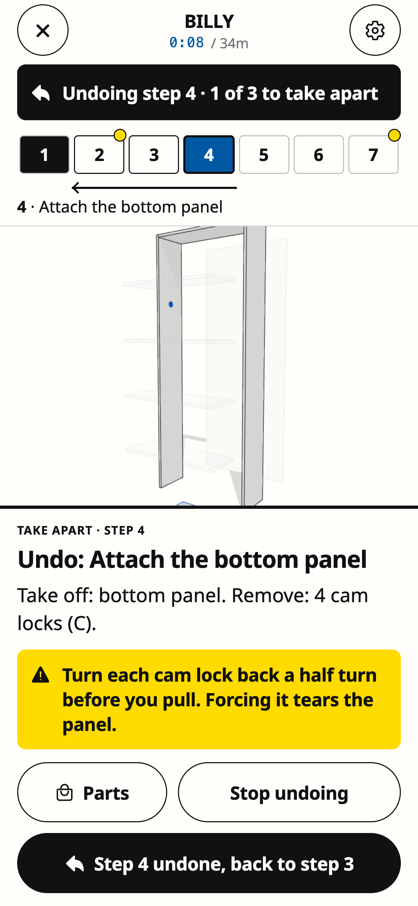

# MONTERA mobile

A low-fidelity but working mobile prototype of [MONTERA](https://github.com/phintruong/MONTERA) —
interactive 3D assembly guidance for IKEA flat-pack furniture. The web MVP answers
"what does this step look like in 3D?"; this is what the same idea feels like on a
phone, where you are actually sitting on the floor with the parts.

Built with Expo + React Native, so it runs on a real device via Expo Go.

This build carries the fixes from the team's paper-prototype study (4 participants)
and mentor feedback: one hero action on home, part letters instead of six-digit
codes, a parts bag with a 1:1 screw view, critical-step checks, a step timeline,
an undo flow that walks you back step by step, a Wizard-of-Oz "Hey IKEA" voice
banner, restart behind a two-step confirm, and a fourth guided product (HUTTEN).



---

## Run it

```bash
npm install
npx expo start
```

Then scan the QR code with **Expo Go** on your phone, or press `i` for the iOS
simulator / `a` for Android.

The camera scanners want a physical device to be interesting. In the simulator
they fall back to a simulated viewfinder and still resolve, so the whole flow is
demoable without a camera.

## Design

Ported from the web app's `DESIGN.md`, which derives from IKEA.com tokens and the
paper manual — so this is the same light system, not a mobile reinterpretation.

| Token | Value | Use |
|---|---|---|
| canvas | `#FFFEFB` | page **and** 3D background |
| ink | `#111111` | text, part outlines, dark fills |
| ink-soft | `#484848` | secondary text |
| hairline | `#DADADA` | 1 px dividers and outlines |
| blue | `#0058A3` | primary action, active parts |
| yellow | `#FFDB00` | current step, critical-step markers, warning blocks |
| red | `#BA2318` on `#FBEAE8` | **only** checks still open when Next is pressed |

Three rules do most of the work, and a test enforces each:

- **Flat.** No shadows, no blur. Separation comes from hairlines and colour blocks.
- **Blue is the primary action; yellow never carries text.** Yellow on white is
  about 1.5:1, so it is only ever a fill or a marker — text on yellow is ink.
- **The 3D is a line drawing.** Parts are canvas-white with ink edges, blue edges
  on the part being fitted, light grey on parts not yet reached. No floor grid —
  only a soft contact shadow, which ghosted parts do not cast.

Type is Noto Sans in 400 and 700 only, loaded via `@expo-google-fonts/noto-sans`;
if the font fails to load the app still renders in the system face.

## Test it

```bash
npm test          # 140 unit tests
npm run typecheck # strict TypeScript
```

The logic layer — catalogue, generators, pose engine, scanners, study maths, part
letters, the Next/undo rules, the simulated voice, real-size maths —
imports nothing from React Native, so it runs under plain Node with no native
mocking. The suite's load-bearing checks are the cross-file invariants that fail
silently in the app rather than throwing:

- every guide step references a part id the generator **actually emits** (a typo or
  generator rename otherwise makes that part never appear, with no error anywhere)
- every guide places **all** of its product's parts by the final step
- authored per-step camera angles sit inside `useOrbit`'s clamp, so no step parks
  the camera below the floor
- each guided build totals **less** than the paper baseline it claims to beat
- article numbers and EANs are unique, so a scan is never ambiguous
- the study comparison only averages products built under **both** conditions
- the design rules above: every text colour clears WCAG AA on canvas, and no
  source file uses yellow as a text or icon colour
- every fitting a guide uses (in steps or `{hw:id}` tokens in text) has a unique
  letter, and no rendered step text leaks a token or a six-digit code
- step text is one or two short sentences; every step has one or two checks;
  critical steps stay under half of any guide
- a critical step holds the first Next on open checks and passes the second;
  ordinary steps never hold
- undo from step 4 to step 2 runs 4, 3, 2 and lands on 2; the action label
  never says Done or Next
- the HUTTEN rack fits IKEA's 33 × 30 × 34 cm outside size and its rods stop at
  the rails and posts; orientation dots sit on the faces the steps name

UI layout and 3D rendering are not unit tested — those are verified by running the
app. The screenshots in `screenshots/` are from `npx expo start --web` at 390 × 844
(headless Chrome), not from the iOS Simulator, where react-three-fiber draws
nothing under Expo Go.

---

## What is in it

### Home: one thing to do
One hero card, about 60% of the screen: **Start a build → Scan the box**, with
"Pick from the catalogue" as a text link. If a build is in progress, a single
**Continue** row sits above it ("BILLY · Step 4 of 7"); more than one shows an
"N more in progress" link, not more cards. **Already partway through?** opens
`/partway`: pick the product, then the step you are on, and the build opens there.
Many people only reach for the app after a mistake, so this is a first-class entry.

### Four scanners
All reachable from the **Scan** tab, each with its own reticle and read behaviour.
A result leads to one large primary button: "Start building LACK", "Open step 3"
(manual page: the mid-build entry in practice) or "Open the parts bag" (hardware,
shown with part letters).

| Scanner | What it does | Real or simulated |
|---|---|---|
| **Article number** | Reads the barcode or 8-digit article number off the flat-pack label and opens that product | **Real** — any EAN-13/EAN-8/Code 128/QR in frame is decoded by `expo-camera` and looked up against the catalogue |
| **Box / product photo** | Identifies the model from a photo of the box or the assembled item | Simulated, returned as a confidence-ranked match list |
| **Manual page** | Finds which step of the paper manual you are on and opens that exact step | Simulated, resolves to a step index |
| **Loose hardware** | Names the fittings in front of you by letter and opens the parts bag | Simulated, reads from the product's fittings list |

Every scanner has a **demo target** control at the bottom of the viewfinder. Tap it
to cycle which product the scan will resolve to, so a live demo never surprises
you. There is also a keyboard fallback on the Scan tab — type `404.312.09` — for
rooms with bad lighting.

### Four ways to view a product
The viewer (`/viewer/[id]`) has a mode switcher:

- **Solid** — the finished product, drag to orbit, pinch to zoom
- **Exploded** — every panel pushed out along the direction it is fitted from, with a separation slider
- **Parts** — tap any piece to isolate it; everything else drops to a ghost
- **Size** — wireframe footprint cage plus the real width/depth/height

The camera pulls back as the separation slider rises, so a fully exploded unit
still fits the frame.

### Step-by-step build mode
The core screen (`/build/[id]`, `?step=3` to open mid-build). Parts from earlier
steps sit assembled, the current step's parts float just off their destination,
and later parts are ghosted.

- **Short steps.** One or two sentences; extra detail is a tip. Fittings are named
  by letter: "Push dowels (A) into the small holes."
- **Done when.** Each step has one or two checks phrased as a visible end state.
- **Critical steps only.** A step with a warning (mirrored panels, a pegged shelf,
  wall anchoring) is critical: a yellow warning block, and the first Next with
  checks open does not advance. The checks turn red in place, the heading becomes
  "Check these first", the button becomes "Next anyway". Ordinary steps are one tap.
- **Timeline.** Numbered, tappable step pips; done steps ink, the current one
  yellow, critical steps carry a yellow marker up front. Press shows the title,
  release jumps.
- **Parts bag** from step 1: every fitting with its letter, this step's first. Tap
  one for a drawing at real size ("Hold yours against the screen") and **Compare**
  with its look-alike (BILLY's 20 mm and 25 mm screws, the study task). Real size
  is calibrated against a bank card's 53.98 mm short edge; until then drawings say
  "Not to scale yet". HUTTEN's fittings are estimates and never claim real size.
  The six-digit IKEA code is small print here and nowhere else.
- **Something's wrong → Which step went wrong?** Enters **undo mode**: a black
  banner ("Undoing step 4 · 1 of 3 to take apart"), the timeline drawn with an
  arrow back to the chosen step, and the 3D lifting off the parts being removed.
  Steps come apart in reverse, one at a time, each saying what to remove, with a
  caution for threaded, nailed or cam-locked joints. The action bar names the
  transition ("Step 4 undone, back to step 3"), never "Done" or "Next". At the end:
  "Back on track. Redo step 2."
- **"Hey IKEA" voice (simulated).** An always-on banner with four states:
  listening, heard (caption), acting (command echoed), and not understood
  ("Didn't catch that. Tap Next or try again"). A chime and a haptic play on wake.
  Every command also has a big on-screen button.
- **Settings** (gear): show/hide unfitted parts, the voice wizard, and **Restart
  this build** behind a two-step confirm that names the cost ("You are on step 4 of
  7. Restarting loses your place."). Nothing on the build screen discards progress
  in one tap.
- Swipe the sheet sideways to change step, timer against the baseline, screen kept
  awake, haptics, saved progress.
- **Orientation marks.** Mentors allowed small changes to the physical product, so
  faces that must point one way carry a blue dot in 3D (BILLY's side panels face
  in, HUTTEN's posts face out) and the steps refer to it.

### Voice wizard (facilitator)
There is no speech recognition: voice is Wizard-of-Oz, scripted so sessions are
comparable. Long-press the voice banner, or open the gear → **Voice wizard**, to
fire "next", "back", "repeat", "undo" or "parts" (each with the line the
participant is scripted to say), type a free-text "heard" caption (parsed like
speech), or force "not understood". **Fail the wake word at step N** (also on the
Study tab) makes the first command on that step fail once, to test the fallback
on purpose. The wizard runs on the same phone, because state is in memory only.

### Study mode
MONTERA's research angle: paper manual as the control condition against the 3D
guide. Aggregate and per-product comparison bars, a session log with each run's
delta against baseline, and an **Export** button that writes the sessions to JSON
and opens the share sheet.

---

## How the 3D works

There are no model files in this repo. Every product is described only by its real
IKEA dimensions plus a generator name:

```ts
{ gen: 'grid', w: 77, d: 39, h: 77, cols: 2, rows: 2, t: 3.5 }   // KALLAX 2×2
```

`src/engine/generators.ts` turns that into the actual panels, legs, dividers and
back boards that come in the box, with **deterministic part ids** (`side-l`,
`shelf-3`, `div-v-1`). That matters because it means the hand-authored guides in
`src/data/guides.ts` can reference parts by id without any asset pipeline — and
every product in the catalogue gets a 3D model, an exploded view and a parts
inspector for free.

`src/engine/pose.ts` is the pose engine: given a product, a guide and the current
step or view mode, it resolves where every part should be and how opaque it is.
Screens never position anything themselves — they pass a `mode` and a `step`.

The same generated geometry also powers the list thumbnails: `src/ui/Thumb.tsx`
projects the parts through a fixed isometric camera and paints them as SVG
polygons back-to-front, so a 34-row catalogue costs zero GL contexts.

---

## Catalogue

35 seeded products across the three tiers MONTERA uses:

- **Guided** (4) — LACK side table, BILLY bookcase, KALLAX 2×2, HUTTEN 9-bottle wine rack. Hand-authored steps with checks, letters and critical-step warnings.
- **3D model** (18) — procedural model, dimensions, fittings list and a baseline time, but no authored steps.
- **Parts only** (13) — catalogue depth so search has something to find.

**HUTTEN** follows IKEA manual AA-49900-4 and the web app's `scripts/gen-hutten.mjs`
(read only). Only its outside size (33 × 30 × 34 cm) is IKEA's; post, rail, rod and
fitting sizes are estimates from photos, and its 12-minute baseline is the team's
estimate, labelled "est." in the app, not a recorded time. The real build tips the
rack over twice; the mobile pose engine only slides parts into place, so those two
steps (5 and 8) are text only and the second frame appears in place in step 2.

Dimensions, article numbers and prices track real listings. Hardware codes follow
IKEA's six-digit fittings numbering and are representative rather than
authoritative. Baseline timings reference the IKEA-ASM, IKEA-Manual and IKEA
Manuals-at-Work datasets (CC BY-NC / CC BY-NC-SA); the seeded study sessions are
illustrative, not collected data.

---

## Layout

```
app/                      expo-router routes
  (tabs)/
    index.tsx             Home — one hero action, one Continue row, partway entry
    scan.tsx              Scanner hub + type-an-article-number fallback
    catalog.tsx           Search, category and detail-level filters
    study.tsx             Paper vs 3D comparison, voice wizard settings, JSON export
  product/[id].tsx        Hero 3D, specs, panel list, fittings bag
  viewer/[id].tsx         Solid / exploded / parts / size
  build/[id].tsx          Step player: checks, timeline, parts bag, undo, voice
  parts/[id].tsx          Parts bag as a screen (hardware scanner, product page)
  partway.tsx             "Already partway through?": product, then step
  scanner/[mode].tsx      All four scanners
src/
  data/                   types, catalogue, hardware, authored guides
  engine/                 generators, pose engine, scanner logic, letters,
                          build rules (Next/undo), voice, real-size maths, marks
  three/                  Canvas, camera rig, part meshes, touch orbit
  ui/                     design tokens, components, thumbnails, timeline,
                          parts bag, sheet, voice banner and wizard
  store/                  progress, recents, study sessions, calibration, voice
```

## Known prototype edges

- Three of the four scanners are simulated by design; the article-number one is real.
- The 3D drops per-finish colour: a black-brown LACK and a white BILLY both render
  as white-with-ink-edges, because that is what the line-drawing style specifies.
  The finish is still named in the product's text.
- Procedural models read as the right product but are not accurate down to the fitting — a KALLAX divider is a box, not a routed panel.
- Voice is Wizard-of-Oz: no speech recognition. The chime uses `expo-audio`
  (in Expo Go); on web the browser may block it until the first tap.
- Real-size drawings depend on the bank-card calibration; device DPI is not used.
- State is in memory only. Progress and sessions reset when the app is reloaded, and **Reset demo data** in Study mode restores the seeded set deliberately.
- Drawers and doors are rendered as faces rather than opening assemblies.

## Open it on a phone

Install **Expo Go**, then from this folder run:

```
npx expo start --tunnel ngrok
```

and scan the QR code with the iPhone Camera (Android: Expo Go → Scan QR code). The tunnel works from any
network and needs no Expo login. Plain `npx expo start` only works when the phone and the computer share a
network that lets devices talk to each other (campus Wi-Fi often doesn't).
